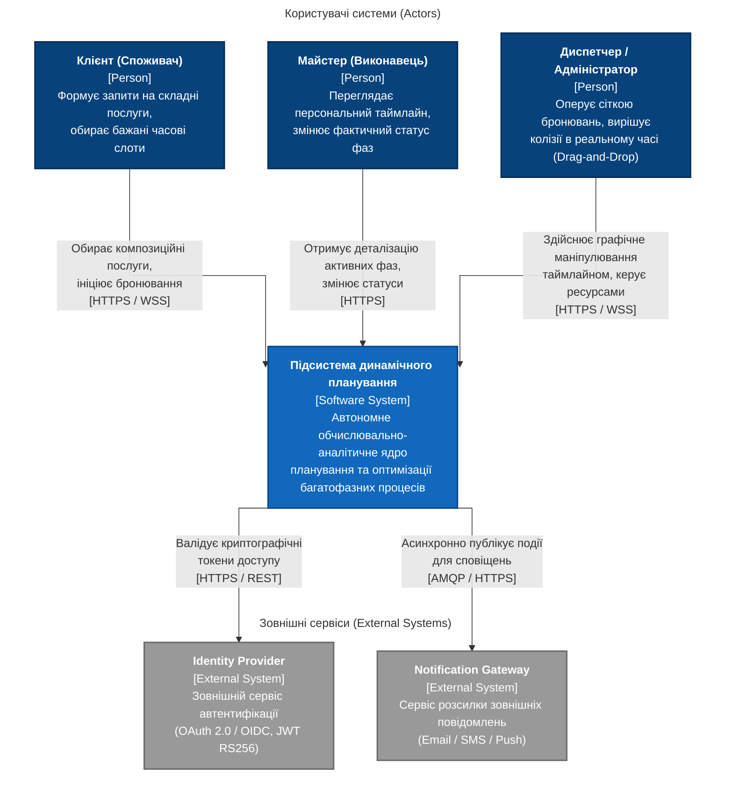
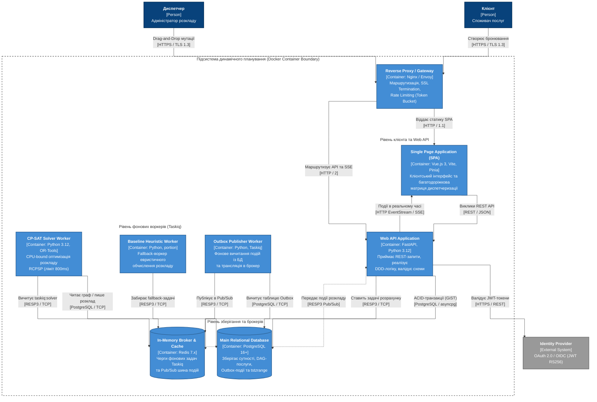
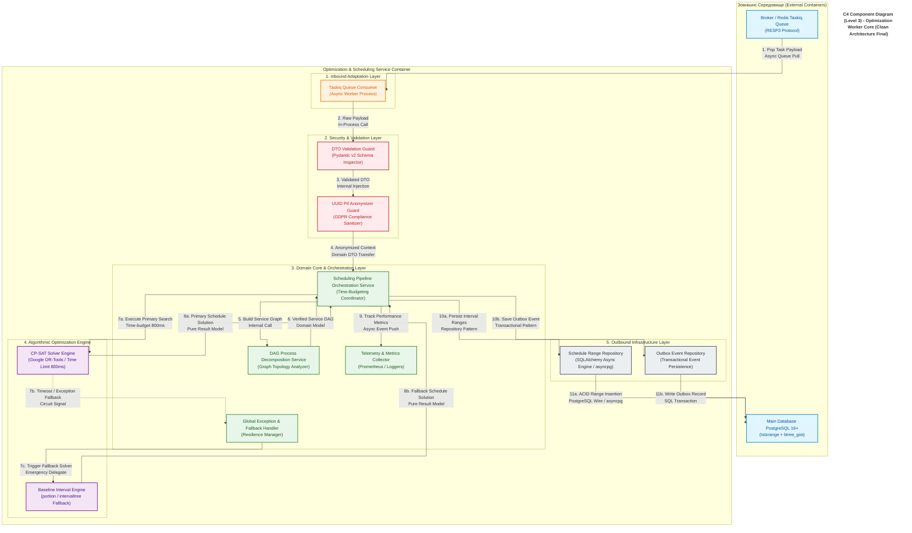
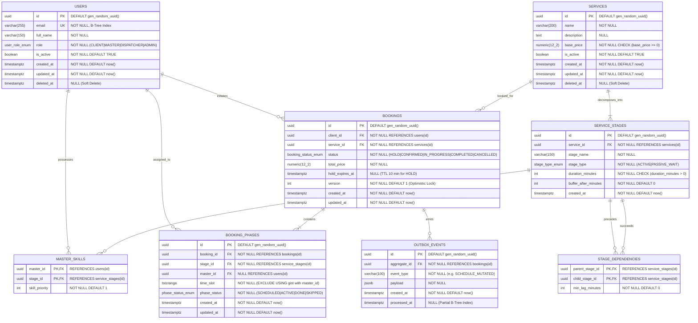
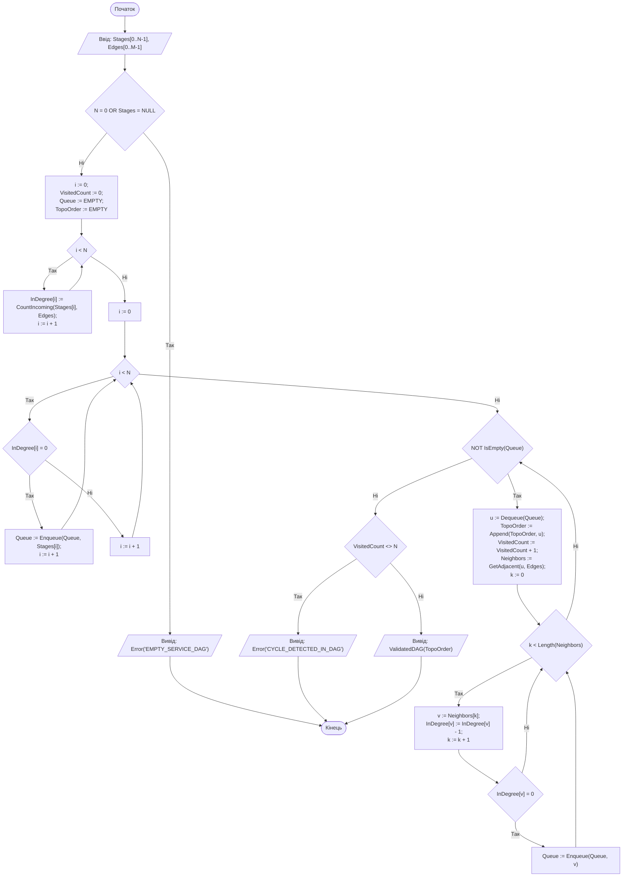
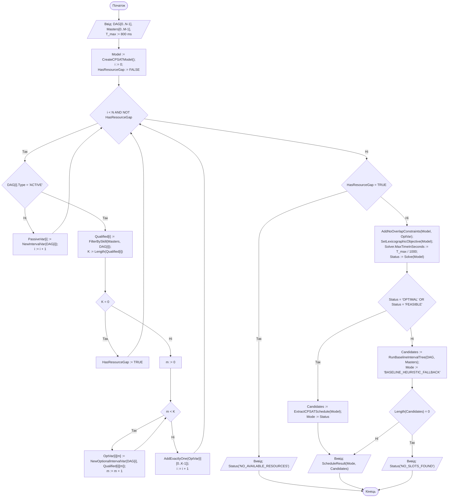

# Розділ 2. Проєктування архітектури системи

**Проєкт:** Підсистема динамічного планування та оптимізації багатофазних процесів у б'юті-індустрії  
**Методологія моделювання:** C4 Model (Simon Brown) / Clean Architecture / Domain-Driven Design (DDD)  
**Контрактна база вимог:** [Специфікація вимог (SRS — ISO/IEC/IEEE 29148)](./srs.md)  
**Журнал рішень:** [ADR-001: Контроль конкурентного доступу та неперетин інтервалів](./adr/0001-choice-of-technology.md)

---

## 2.1. Контекстне та контейнерне моделювання системи (C4 Model)

### 2.1.1. C4 Level 1: System Context Diagram (Системний контекст) {#diagram-level1}

#### Технічний опис системного контексту та трасування вимог (Level 1):
* **Зовнішні актори (Person):**
  * **Клієнт (Споживач):** Взаємодіє з підсистемою через шифрований канал `HTTPS / WSS` для вибору композитних послуг та фіксації часових слотів відповідно до контексту системи ([System Context](./srs.md#1-system-context-контекст-системи)).
  * **Майстер (Виконавець) та Диспетчер / Адміністратор:** Отримують персоніфіковані розклади та керують сіткою ресурсів із розмежуванням прав доступу за ролями (RBAC), що трасується до вимоги [SRS-FUN-AUTH-02](./srs.md#21-модуль-автентифікації-та-контролю-доступу-auth).
* **Зовнішні програмні системи (`System_Ext`):**
  * **`Identity Provider`:** Забезпечує федеративну автентифікацію за протоколами OAuth 2.0 / OIDC та верифікацію криптографічних підписів токенів `JWT RS256` ([SRS-FUN-AUTH-01](./srs.md#21-модуль-автентифікації-та-контролю-доступу-auth), [SRS-NFR-SEC-01](./srs.md#3-non-functional-requirements-нефункціональні-вимоги)).
  * **`Notification Gateway`:** Виконує асинхронну доставку зовнішніх сповіщень про зміну статусу візиту через протокол `AMQP / HTTPS`.

---

### 2.1.2. C4 Level 2: Container Diagram (Діаграма контейнерів) {#diagram-level2}

#### Технічний опис контейнерів, мережевих протоколів та трасування (Level 2):
1. **`Reverse Proxy / Gateway (Nginx / Envoy)`:** Вхідний шлюз периметра. Забезпечує термінацію `TLS 1.3` ([SRS-NFR-SEC-01](./srs.md#3-non-functional-requirements-нефункціональні-вимоги)) та маршрутизацію трафіку до SPA (`HTTP / 1.1`) і бекенд-API (`HTTP / 2`).
2. **`Single Page Application (Vue.js 3)`:** Клієнтський інтерфейс диспетчеризації. Виконує запити мутацій через `REST / JSON (HTTPS)` та утримує однонапрямний потік оновлень розкладу за протоколом `HTTP EventStream (W3C SSE)` ([SRS-FUN-STREAM-02](./srs.md#25-реактивний-сервіс-трансляції-станів-stream)).
3. **`Web API Application (FastAPI)`:** Асинхронний сервіс бізнес-логіки та валідації Pydantic v2, розрахований на затримку $p_{95} \le 100$ мс при $500$ RPS ([SRS-NFR-PERF-01](./srs.md#3-non-functional-requirements-нефункціональні-вимоги)). Взаємодіє з СУБД через `PostgreSQL Wire Protocol / TCP (asyncpg)`.
4. **`CP-SAT Solver Worker` та `Baseline Heuristic Worker`:** Ізольовані у dedicated Docker-контейнерах ([SRS-NFR-DEVOPS-01](./srs.md#3-non-functional-requirements-нефункціональні-вимоги)) фонові воркери. Реалізують лексикографічну оптимізацію RCPSP (`Google OR-Tools`) з жорстким time-budgeting 800 мс та автоматичним переключенням на інтервальний евристичний аналізатор (`portion` / `intervaltree`) згідно з [SRS-FUN-SOLV-01 — SRS-FUN-SOLV-03](./srs.md#23-алгоритмічне-ядро-оптимізації-solv) та [SRS-NFR-PERF-02](./srs.md#3-non-functional-requirements-нефункціональні-вимоги).
5. **`Outbox Publisher Worker (Taskiq)`:** Вичитує невідправлені доменні події з таблиці Outbox у PostgreSQL та публікує їх у канали `Redis Pub/Sub` за протоколом `RESP3 Protocol / TCP`, ліквідуючи аномалії Dual-Write та забезпечуючи відновлення після збоїв брокера ([SRS-FUN-STREAM-01](./srs.md#25-реактивний-сервіс-трансляції-станів-stream), [SRS-NFR-REL-02](./srs.md#3-non-functional-requirements-нефункціональні-вимоги)).
6. **`Main Relational Database (PostgreSQL 16+)`:** Єдине джерело істини (Single Source of Truth). Використовує темпоральний тип `tstzrange` та індексне обмеження `EXCLUDE USING gist` (розширення `btree_gist`) для гарантування $0\%$ подвійних бронювань ([SRS-FUN-DB-01](./srs.md#24-сервіс-транзакційного-контролю-колізій-db), [SRS-NFR-REL-01](./srs.md#3-non-functional-requirements-нефункціональні-вимоги)). Архітектурне обґрунтування вибору зафіксовано в [ADR-001](./adr/0001-choice-of-technology.md).
7. **`In-Memory Broker & Cache (Redis 7.x)`:** Обслуговує асинхронні черги задач `Taskiq` (включно з механізмом вивільнення тимчасових холдів слотів за [SRS-FUN-DB-02](./srs.md#24-сервіс-транзакційного-контролю-колізій-db)) та шину подій `Pub/Sub`.

---

## 2.2. Компонентне моделювання критичного сервісу системи {#diagram-level3}

Як критичний сервіс для деталізації на рівень **C4 Component (Level 3)** обрано контейнер **`Optimization & Scheduling Service (Taskiq Worker Pool + CP-SAT Core)`**, спроєктований за принципами **Clean Architecture** та **Dependency Inversion**.

#### Деталізований опис внутрішніх компонентів та наскрізне трасування (Level 3):

1. **Шар вхідних адаптерів (`Inbound Adaptation Layer`):**
   * **`Taskiq Queue Consumer`:** Асинхронний консюмер подій, що отримує завдання з черги Redis (`RESP3`) за патерном *Event-Driven Consumer* та передає необроблений пейлоад у шар валідації без прямого доступу до інфраструктури БД.
2. **Шар безпеки та валідації (`Security & Validation Layer`):**
   * **`DTO Validation Guard (Pydantic v2)`:** Виконує сувору перевірку вхідних структур даних перед їх потраплянням у доменне ядро.
   * **`UUID PII Anonymizer Guard`:** Гарантує очищення вхідного контексту від персональних даних (PII), залишаючи лише знеособлені ідентифікатори `UUID` та часові параметри на виконання вимоги [SRS-NFR-SEC-02](./srs.md#3-non-functional-requirements-нефункціональні-вимоги).
3. **Шар доменного ядра та координації (`Domain Core & Orchestration Layer`):**
   * **`Scheduling Pipeline Orchestration Service`:** Центральний координатор процесу (патерн *Mediator / Orchestrator*). Керує життєвим циклом розрахунку, контролює жорсткий часовий бюджет 800 мс ([SRS-FUN-SOLV-03](./srs.md#23-алгоритмічне-ядро-оптимізації-solv)) та ізолює алгоритмічні рушії від побічних ефектів запису в БД.
   * **`DAG Process Decomposition Service`:** Перетворює композитну послугу у спрямований ациклічний граф (DAG) із розділенням на активні та пасивні фази та перевіркою на ациклічність згідно з вимогами [SRS-FUN-DAG-01](./srs.md#22-модуль-декомпозиції-та-граф-моделювання-dag) та [SRS-FUN-DAG-02](./srs.md#22-модуль-декомпозиції-та-граф-моделювання-dag).
   * **`Global Exception & Fallback Handler`:** Компонент підвищення відмовостійкості (*Resilience Manager*), що перехоплює таймаути або винятки основного солвера та делегує розрахунок резервному евристичному рушію.
   * **`Telemetry & Metrics Collector`:** Збирає операційні метрики затримок ($p_{95}$ Latency) для верифікації вимоги продуктивності [SRS-NFR-PERF-02](./srs.md#3-non-functional-requirements-нефункціональні-вимоги).
4. **Алгоритмічне ядро оптимізації (`Algorithmic Optimization Engine`):**
   * **`CP-SAT Solver Engine (Google OR-Tools)`:** Математичне ядро оптимізації (чиста доменна функція), що будує модель із змінними `NewOptionalIntervalVar`, обмеженнями `AddNoOverlap` ([SRS-FUN-SOLV-01](./srs.md#23-алгоритмічне-ядро-оптимізації-solv)) та виконує лексикографічну мінімізацію цільової функції ([SRS-FUN-SOLV-02](./srs.md#23-алгоритмічне-ядро-оптимізації-solv)).
   * **`Baseline Interval Engine (portion / intervaltree)`:** Резервний евристичний аналізатор інтервальних дерев для миттєвого пошуку допустимого розкладу у разі перевищення ліміту 800 мс ([SRS-FUN-SOLV-03](./srs.md#23-алгоритмічне-ядро-оптимізації-solv)).
5. **Шар вихідної інфраструктури (`Outbound Infrastructure Layer`):**
   * **`Schedule Range Repository`:** Реалізує патерн *Repository* поверх `SQLAlchemy 2.0 (asyncpg)`. Фіксує розраховані часові діапазони `tstz

   ---

## 2.4. Проєктування та моделювання баз даних {#database-design}

Логіко-фізична модель збереження даних побудована для реляційної СУБД **PostgreSQL 16+** у Третій нормальній формі (**3NF**) із використанням діапазонного типу `TSTZRANGE` та індексного розширення `btree_gist` для забезпечення декларативного інваріанта неперетину інтервалів ([SRS-FUN-DB-01](./srs.md#24-сервіс-транзакційного-контролю-колізій-db), [ADR-001](./adr/0001-choice-of-technology.md)).

#### Опис ключових контурів та індексів БД:
* **Довідниковий та графовий контур (`USERS`, `SERVICES`, `SERVICE_STAGES`, `STAGE_DEPENDENCIES`, `MASTER_SKILLS`):** Забезпечує декомпозицію композитних послуг у спрямований ациклічний граф (**DAG**) із розділенням на активні (`ACTIVE`) та пасивні (`PASSIVE_WAIT`) фази ([SRS-FUN-DAG-01](./srs.md#22-модуль-декомпозиції-та-граф-моделювання-dag)) та формує матрицю компетенцій для розв'язувача CP-SAT.
* **Транзакційний контур (`BOOKINGS`, `BOOKING_PHASES`):** Підтримує двоетапне резервування (`HOLD` із TTL 10 хв та оптимістичним блокуванням `version` за [SRS-FUN-DB-02](./srs.md#24-сервіс-транзакційного-контролю-колізій-db)) і декларативне обмеження `EXCLUDE USING gist (master_id WITH =, time_slot WITH &&)` для гарантування $0\%$ подвійних бронювань ([SRS-NFR-REL-01](./srs.md#3-non-functional-requirements-нефункціональні-вимоги)).
* **Подієвий контур (`OUTBOX_EVENTS`):** Реалізує патерн *Transactional Outbox* із частковим покриваючим індексом `WHERE processed_at IS NULL` для атомарного запису подій мутації в одній ACID-транзакції з бронюванням ([SRS-FUN-STREAM-01](./srs.md#25-реактивний-сервіс-трансляції-станів-stream)).

---

## 2.5. Специфікація міжсервісних контрактів (API) {#api-contracts}

Взаємодія між клієнтським застосунком **`Single Page Application (Vue.js 3)`** та сервісом **`Web API Application (FastAPI)`** спроєктована за підходом **API-First Design** для забезпечення наскрізної типізації через автогенерацію SDK (`@hey-api/openapi-ts`) та валідацію моделей `Pydantic v2`.

Деталізовану специфікацію ендпоінтів, моделей даних (`components/schemas`), схем безпеки `JWT RS256` (`BearerAuth`) та стандартизованих відповідей про помилки (`RFC 9457 ProblemDetails`, включно з `409 Conflict` при спрацюванні GiST-обмеження) у форматі **OpenAPI 3.0.3** зафіксовано у файлі **[openapi.yaml](./api/openapi.yaml)**.

---

## 2.6. Моделювання логіки критичних вузлів {#critical-algorithms}

### 2.6.1. Алгоритм 1: Топологічна декомпозиція та валідація ациклічності графа послуги (Kahn's DAG Validation)

1. **Вхідні дані:** Масив етапів композитної послуги `Stages[0..N-1]` та масив орієнтованих ребер залежностей `Edges[0..M-1]`.
2. **Перевірка виродженості:** Якщо `N = 0 OR Stages = NULL`, алгоритм переривається із поверненням винятку `EMPTY_SERVICE_DAG`.
3. **Ініціалізація:** Встановлюються змінні `i := 0`, `VisitedCount := 0`, `Queue := EMPTY`, `TopoOrder := EMPTY`. Для кожного індексу `i` (`0 <= i < N`) обчислюється напівстепінь заходу `InDegree[i] := CountIncoming(Stages[i], Edges)`. Вузол із умовою `InDegree[i] = 0` додається до черги `Queue := Enqueue(Queue, Stages[i])`.
4. **Топологічне сортування (алгоритм Кана):** Поки виконується умова `NOT IsEmpty(Queue)`, вилучається вершина `u := Dequeue(Queue)`, оновлюються `TopoOrder := Append(TopoOrder, u)` та `VisitedCount := VisitedCount + 1`. Для кожного суміжного вузла `v := Neighbors[k]` (`0 <= k < Length(Neighbors)`) виконується декремент `InDegree[v] := InDegree[v] - 1`; при досягненні `InDegree[v] = 0` вершина `v` додається у чергу `Queue`.
5. **Верифікація ациклічності:** Якщо `VisitedCount <> N`, фіксується наявність контуру в графі та повертається помилка `CYCLE_DETECTED_IN_DAG`; інакше повертається впорядкований граф `ValidatedDAG(TopoOrder)`.

### 2.6.2. Алгоритм 2: Оркестрація лексикографічної оптимізації RCPSP із тайм-бюджетом та fallback-переключенням

1. **Вхідні дані:** Топологічно відсортований граф `DAG[0..N-1]`, множина виконавців `Masters[0..M-1]`, жорсткий ліміт часу обчислення `T_max := 800 ms`.
2. **Побудова моделі обмежень:** Ініціалізується модель `Model := CreateCPSATModel()`, лічильник `i := 0` та прапорець дефіциту ресурсів `HasResourceGap := FALSE`. У циклі при `i < N AND NOT HasResourceGap`:
   * Якщо `DAG[i].Type = 'ACTIVE'`, формується підмножина кваліфікованих майстрів `Qualified[i] := FilterBySkill(Masters, DAG[i])`. Якщо `Length(Qualified[i]) = 0`, встановлюється `HasResourceGap := TRUE`. Інакше для кожного `m` (`0 <= m < Length(Qualified[i])`) створюється опціональний інтервал `OptVar[i][m] := NewOptionalIntervalVar(DAG[i], Qualified[i][m])` та накладається обмеження вибору рівно одного виконавця `AddExactlyOne(OptVar[i][0..K-1])`.
   * Якщо `DAG[i].Type <> 'ACTIVE'` (фаза `PASSIVE_WAIT`), реєструється фіксований часовий інтервал без прив'язки до виконавця `PassiveVar[i] := NewIntervalVar(DAG[i])`.
3. **Перевірка доступності ресурсів:** Якщо `HasResourceGap = TRUE`, виконання припиняється зі статусом `NO_AVAILABLE_RESOURCES`.
4. **Оптимізація та резервування (Fallback):** Накладаються констрейнти неперетину `AddNoOverlapConstraints(Model, OptVar)`, задається векторна лексикографічна цільова функція `SetLexicographicObjective(Model)` та запускається розв'язувач із обмеженням `Solver.MaxTimeInSeconds := T_max / 1000`.
   * Якщо `Status = 'OPTIMAL' OR Status = 'FEASIBLE'`, формується результат `Candidates := ExtractCPSATSchedule(Model)`.
   * Інакше (при перевищенні бюджету часу або помилці) управління передається на резервний рушій інтервальних дерев `Candidates := RunBaselineIntervalTree(DAG, Masters)`, `Mode := 'BASELINE_HEURISTIC_FALLBACK'`. Якщо `Length(Candidates) = 0`, повертається статус `NO_SLOTS_FOUND`.
5. **Вихідні дані:** Повертається структура `ScheduleResult(Mode, Candidates)`.

### 2.6.3. Алгоритм 3: Атомарна фіксація темпоральних інтервалів (`tstzrange`) та патерн Transactional Outbox

1. **Вхідні дані:** Ключ ідепотентності `IdempotencyKey`, ідентифікатори `ClientID`, `ServiceID`, масив фаз розкладу `Phases[0..N-1]` та час життя холду `TTL := 600 s`.
2. **Контроль ідепотентності:** Виконується пошук `CachedResp := CheckIdempotencyStore(IdempotencyKey)` у сховищі Redis 7.x. Якщо `CachedResp <> NULL`, повертається збережена відповідь `HTTP 200 (CachedResp)` без відкриття транзакції запису.
3. **Транзакційне збереження та захист GiST:** Відкривається транзакція БД `BeginTransaction(Isolation := 'READ COMMITTED')`, фіксується дедлайн `ExpiresAt := NowUTC() + TTL`, генерується `BookingID := GenerateUUIDv4()` і створюється агрегат `BOOKINGS` зі статусом `Status := 'HOLD'` та `Version := 1`.
4. **Запис темпоральних діапазонів:** У циклі при `i < N AND DbError = NULL` для кожної фази конструюється напіввідкритий інтервал `Range[i] := BuildTSTZRange(Phases[i].Start, Phases[i].End)` та виконується вставка в таблицю `BOOKING_PHASES`. При виникненні помилки СУБД (`Result.Error <> NULL`) фіксується код `DbError := Result.SqlState`.
5. **Обробка колізій та фіксація події Outbox:**
   * Якщо `DbError <> NULL`, виконується `RollbackTransaction()`. При коді `DbError = '23P01'` (спрацювання індексу `EXCLUDE USING gist`) повертається `HTTP 409 Conflict`; при інших системних збоях СУБД — `HTTP 503 Service Unavailable`.
   * Якщо `DbError = NULL`, у межах тієї ж транзакції генерується `EventID := GenerateUUIDv4()` та записується подія `BOOKING_HELD` у таблицю `OUTBOX_EVENTS`, після чого виконується `CommitTransaction()`, збереження ключа ідепотентності та повернення статусу `HTTP 201 Created (BookingID, ExpiresAt)`.

---

## 2.7. Інтеграційний аудит та верифікація цілісності доменів {#integration-audit}

**Статус верифікації:** `APPROVED FOR IMPLEMENTATION (PASS — 0 CRITICAL SHOWSTOPPERS)`

| № | Критерій інтеграційної верифікації | Статус | Коментар аудитора |
| :-: | :--- | :---: | :--- |
| 1 | Узгодженість типів ключів (`UUID`), фінансів (`NUMERIC(12,2)`) та дат (`ISO 8601` $\to$ `TSTZRANGE`) | **PASS** | Повна типова сумісність між [openapi.yaml](./api/openapi.yaml), Pydantic v2 та PostgreSQL 16+ |
| 2 | Покриття захистом від стану гонитви (Race Conditions) та подвійних бронювань | **PASS** | `EXCLUDE USING gist` у БД $\leftrightarrow$ `SQLSTATE 23P01` в Алгоритмі 3 $\leftrightarrow$ `409 Conflict` в API |
| 3 | Узгодженість механізму підтвердження холду (`HOLD` $\to$ `CONFIRMED`) та оптимістичного блокування | **PASS** | `hold_expires_at` + `version` у `BOOKINGS` $\leftrightarrow$ `PATCH /bookings/{booking_id}/confirm` |
| 4 | Атомарність подійної синхронізації (Transactional Outbox $\to$ Redis Pub/Sub $\to$ SSE) | **PASS** | Таблиця `OUTBOX_EVENTS` + Алгоритм 3 $\leftrightarrow$ `GET /schedules/stream` |
| 5 | Академічний нормоконтроль формалізації алгоритмів (`:=`, `AND/OR/NOT`, індекси) | **PASS** | Усі 3 алгоритми відповідають вимогам ДСТУ / ISO 5807 |

**Висновок комісії:** Архітектурний, даталогічний та алгоритмічний контури Розділу 2 є повністю узгодженими, не містять інтеграційних блокерів і затверджуються для переходу до програмної реалізації.