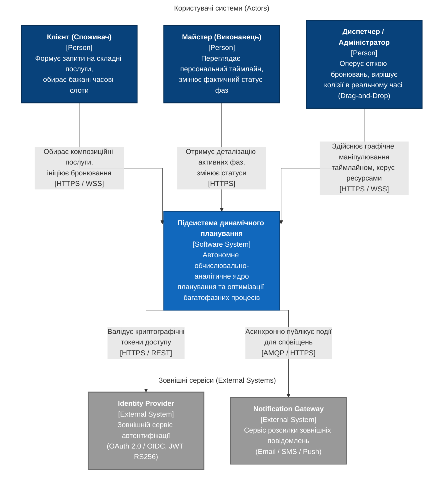
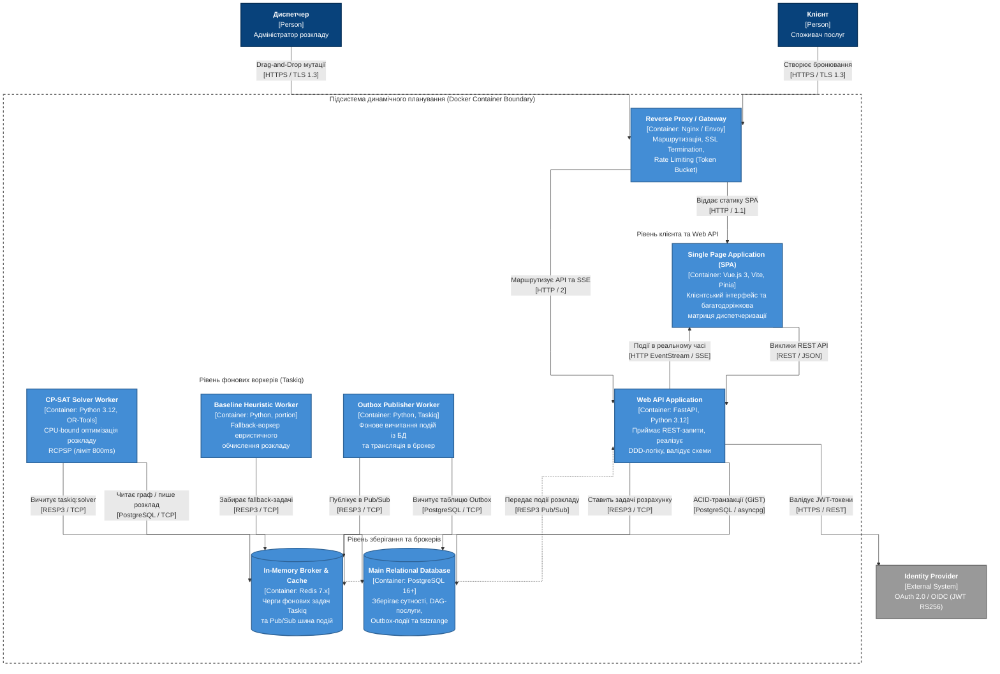
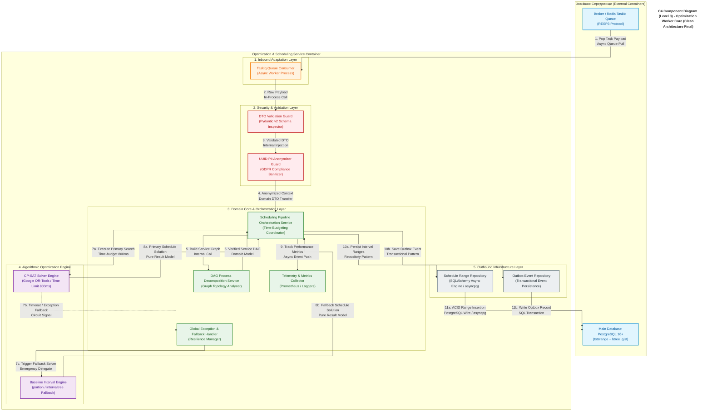

# Розділ 2. Проєктування архітектури системи

**Проєкт:** Підсистема динамічного планування та оптимізації багатофазних процесів у б'юті-індустрії  
**Методологія моделювання:** C4 Model (Simon Brown) / Clean Architecture / Domain-Driven Design (DDD)  
**Контрактна база вимог:** [Специфікація вимог (SRS — ISO/IEC/IEEE 29148)](./srs.md)  
**Журнал рішень:** [ADR-001: Контроль конкурентного доступу та неперетин інтервалів](./adr/0001-choice-of-technology.md)

---

## 2.1. Контекстне та контейнерне моделювання системи (C4 Model)

### 2.1.1. C4 Level 1: System Context Diagram (Системний контекст) {#diagram-level1}

#### Технічний опис системного контексту та трасування вимог (Level 1):
* **Зовнішні актори (Person):**
  * **Клієнт (Споживач):** Взаємодіє з підсистемою через шифрований канал `HTTPS / WSS` для вибору композитних послуг та фіксації часових слотів відповідно до контексту системи ([System Context](./srs.md#1-system-context-контекст-системи)).
  * **Майстер (Виконавець) та Диспетчер / Адміністратор:** Отримують персоніфіковані розклади та керують сіткою ресурсів із розмежуванням прав доступу за ролями (RBAC), що трасується до вимоги [SRS-FUN-AUTH-02](./srs.md#21-модуль-автентифікації-та-контролю-доступу-auth).
* **Зовнішні програмні системи (`System_Ext`):**
  * **`Identity Provider`:** Забезпечує федеративну автентифікацію за протоколами OAuth 2.0 / OIDC та верифікацію криптографічних підписів токенів `JWT RS256` ([SRS-FUN-AUTH-01](./srs.md#21-модуль-автентифікації-та-контролю-доступу-auth), [SRS-NFR-SEC-01](./srs.md#3-non-functional-requirements-нефункціональні-вимоги)).
  * **`Notification Gateway`:** Виконує асинхронну доставку зовнішніх сповіщень про зміну статусу візиту через протокол `AMQP / HTTPS`.

---

### 2.1.2. C4 Level 2: Container Diagram (Діаграма контейнерів) {#diagram-level2}

#### Технічний опис контейнерів, мережевих протоколів та трасування (Level 2):
1. **`Reverse Proxy / Gateway (Nginx / Envoy)`:** Вхідний шлюз периметра. Забезпечує термінацію `TLS 1.3` ([SRS-NFR-SEC-01](./srs.md#3-non-functional-requirements-нефункціональні-вимоги)) та маршрутизацію трафіку до SPA (`HTTP / 1.1`) і бекенд-API (`HTTP / 2`).
2. **`Single Page Application (Vue.js 3)`:** Клієнтський інтерфейс диспетчеризації. Виконує запити мутацій через `REST / JSON (HTTPS)` та утримує однонапрямний потік оновлень розкладу за протоколом `HTTP EventStream (W3C SSE)` ([SRS-FUN-STREAM-02](./srs.md#25-реактивний-сервіс-трансляції-станів-stream)).
3. **`Web API Application (FastAPI)`:** Асинхронний сервіс бізнес-логіки та валідації Pydantic v2, розрахований на затримку $p_{95} \le 100$ мс при $500$ RPS ([SRS-NFR-PERF-01](./srs.md#3-non-functional-requirements-нефункціональні-вимоги)). Взаємодіє з СУБД через `PostgreSQL Wire Protocol / TCP (asyncpg)`.
4. **`CP-SAT Solver Worker` та `Baseline Heuristic Worker`:** Ізольовані у dedicated Docker-контейнерах ([SRS-NFR-DEVOPS-01](./srs.md#3-non-functional-requirements-нефункціональні-вимоги)) фонові воркери. Реалізують лексикографічну оптимізацію RCPSP (`Google OR-Tools`) з жорстким time-budgeting 800 мс та автоматичним переключенням на інтервальний евристичний аналізатор (`portion` / `intervaltree`) згідно з [SRS-FUN-SOLV-01 — SRS-FUN-SOLV-03](./srs.md#23-алгоритмічне-ядро-оптимізації-solv) та [SRS-NFR-PERF-02](./srs.md#3-non-functional-requirements-нефункціональні-вимоги).
5. **`Outbox Publisher Worker (Taskiq)`:** Вичитує невідправлені доменні події з таблиці Outbox у PostgreSQL та публікує їх у канали `Redis Pub/Sub` за протоколом `RESP3 Protocol / TCP`, ліквідуючи аномалії Dual-Write та забезпечуючи відновлення після збоїв брокера ([SRS-FUN-STREAM-01](./srs.md#25-реактивний-сервіс-трансляції-станів-stream), [SRS-NFR-REL-02](./srs.md#3-non-functional-requirements-нефункціональні-вимоги)).
6. **`Main Relational Database (PostgreSQL 16+)`:** Єдине джерело істини (Single Source of Truth). Використовує темпоральний тип `tstzrange` та індексне обмеження `EXCLUDE USING gist` (розширення `btree_gist`) для гарантування $0\%$ подвійних бронювань ([SRS-FUN-DB-01](./srs.md#24-сервіс-транзакційного-контролю-колізій-db), [SRS-NFR-REL-01](./srs.md#3-non-functional-requirements-нефункціональні-вимоги)). Архітектурне обґрунтування вибору зафіксовано в [ADR-001](./adr/0001-choice-of-technology.md).
7. **`In-Memory Broker & Cache (Redis 7.x)`:** Обслуговує асинхронні черги задач `Taskiq` (включно з механізмом вивільнення тимчасових холдів слотів за [SRS-FUN-DB-02](./srs.md#24-сервіс-транзакційного-контролю-колізій-db)) та шину подій `Pub/Sub`.

---

## 2.2. Компонентне моделювання критичного сервісу системи {#diagram-level3}

Як критичний сервіс для деталізації на рівень **C4 Component (Level 3)** обрано контейнер **`Optimization & Scheduling Service (Taskiq Worker Pool + CP-SAT Core)`**, спроєктований за принципами **Clean Architecture** та **Dependency Inversion**.

#### Деталізований опис внутрішніх компонентів та наскрізне трасування (Level 3):

1. **Шар вхідних адаптерів (`Inbound Adaptation Layer`):**
   * **`Taskiq Queue Consumer`:** Асинхронний консюмер подій, що отримує завдання з черги Redis (`RESP3`) за патерном *Event-Driven Consumer* та передає необроблений пейлоад у шар валідації без прямого доступу до інфраструктури БД.
2. **Шар безпеки та валідації (`Security & Validation Layer`):**
   * **`DTO Validation Guard (Pydantic v2)`:** Виконує сувору перевірку вхідних структур даних перед їх потраплянням у доменне ядро.
   * **`UUID PII Anonymizer Guard`:** Гарантує очищення вхідного контексту від персональних даних (PII), залишаючи лише знеособлені ідентифікатори `UUID` та часові параметри на виконання вимоги [SRS-NFR-SEC-02](./srs.md#3-non-functional-requirements-нефункціональні-вимоги).
3. **Шар доменного ядра та координації (`Domain Core & Orchestration Layer`):**
   * **`Scheduling Pipeline Orchestration Service`:** Центральний координатор процесу (патерн *Mediator / Orchestrator*). Керує життєвим циклом розрахунку, контролює жорсткий часовий бюджет 800 мс ([SRS-FUN-SOLV-03](./srs.md#23-алгоритмічне-ядро-оптимізації-solv)) та ізолює алгоритмічні рушії від побічних ефектів запису в БД.
   * **`DAG Process Decomposition Service`:** Перетворює композитну послугу у спрямований ациклічний граф (DAG) із розділенням на активні та пасивні фази та перевіркою на ациклічність згідно з вимогами [SRS-FUN-DAG-01](./srs.md#22-модуль-декомпозиції-та-граф-моделювання-dag) та [SRS-FUN-DAG-02](./srs.md#22-модуль-декомпозиції-та-граф-моделювання-dag).
   * **`Global Exception & Fallback Handler`:** Компонент підвищення відмовостійкості (*Resilience Manager*), що перехоплює таймаути або винятки основного солвера та делегує розрахунок резервному евристичному рушію.
   * **`Telemetry & Metrics Collector`:** Збирає операційні метрики затримок ($p_{95}$ Latency) для верифікації вимоги продуктивності [SRS-NFR-PERF-02](./srs.md#3-non-functional-requirements-нефункціональні-вимоги).
4. **Алгоритмічне ядро оптимізації (`Algorithmic Optimization Engine`):**
   * **`CP-SAT Solver Engine (Google OR-Tools)`:** Математичне ядро оптимізації (чиста доменна функція), що будує модель із змінними `NewOptionalIntervalVar`, обмеженнями `AddNoOverlap` ([SRS-FUN-SOLV-01](./srs.md#23-алгоритмічне-ядро-оптимізації-solv)) та виконує лексикографічну мінімізацію цільової функції ([SRS-FUN-SOLV-02](./srs.md#23-алгоритмічне-ядро-оптимізації-solv)).
   * **`Baseline Interval Engine (portion / intervaltree)`:** Резервний евристичний аналізатор інтервальних дерев для миттєвого пошуку допустимого розкладу у разі перевищення ліміту 800 мс ([SRS-FUN-SOLV-03](./srs.md#23-алгоритмічне-ядро-оптимізації-solv)).
5. **Шар вихідної інфраструктури (`Outbound Infrastructure Layer`):**
   * **`Schedule Range Repository`:** Реалізує патерн *Repository* поверх `SQLAlchemy 2.0 (asyncpg)`. Фіксує розраховані часові діапазони `tstz